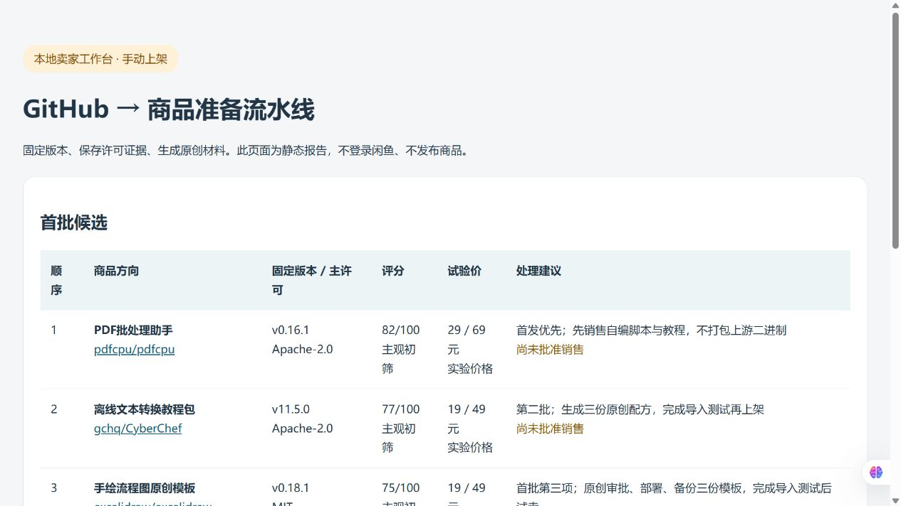

# 本机验收记录

日期：2026-10-12（Asia/Shanghai）。仓库已完整克隆到 `D:\demo_xianyu`，基线提交为 `8c3a298f29ac7b323d3c8b05e60b12f2e4859a22`。

## 环境与已完成验证

- Windows 11 专业版 x64，系统版本 10.0.28000；Python 3.14。
- Docker Engine 29.8.1、Compose 5.5.1，desktop-linux 引擎已启动；引擎可见 8 CPU、约 7.63 GiB 内存。
- Windows：安装包与导入保护测试 21 项通过；自动化测试 20 项通过、1 项跳过（账户没有创建符号链接权限）。
- 本机 WSL2 Debian 13 x86_64 / Python 3.13.5：上述两套回归共 42 项全部通过。这是 WSL 回归，不代表独立 Linux 服务器部署验收。
- 自动化程序 `python automation/daily.py` 成功生成 5 个草稿包与工作台报告；浏览器实际打开本机报告，已采集下方截图。
- 8 个交付 ZIP 重新生成并校验 SHA256 与成员路径；共 128 个文件，不含 `runtime/`、`.local/`、凭据或备份。Linux TAR.GZ 亦已重建。
- Git 忽略规则已验证，`.local/deepseek.env` 和两个本机 `runtime/.env` 均不进入版本控制。

## 本机发现与修复

Windows 默认 GBK 读取 UTF-8 中文快照会抛出 `UnicodeDecodeError`，自动化测试首次运行有 15 项因此报错。n8n 示例工作流也含中文，默认编码可能导致导入错误。

现已在安装、导入、验证脚本中明确指定 UTF-8 文件编码与 Docker 子进程编码；同源 Flowise/AnythingLLM 安装脚本同步修复。增加强制 GBK 环境下的 n8n 中文导入回归，并将 Windows 无符号链接权限记录为显式跳过；WSL 上该项实际通过。

## 尚未完成的实机验收

Docker 官方固定 digest 镜像已尝试拉取，初次拉取持续约 20 分钟仍未完成。随后尝试 n8n 官方 Registry 与备用镜像源的同一 digest，仍未完成。为减少竞争，已暂停 Dify 下载，保留 n8n 下载。

因此目前不能声称以下项目通过：

- Dify 1.17.1 / n8n 2.42.6 容器启动及本机网页可达。
- 真实工作流导入、执行、重复导入与重启数据保留。
- 冷备份与独立空环境恢复。
- 真实 DeepSeek 请求（尚未提供本机测试凭据）。
- Dify / n8n 产品运行截图与独立 Linux 部署。

运行配置已生成并留在本机；未创建产品管理员账户。保留上述待验收状态，完成后再同步 GitHub。

## 实际工作台截图

此图来自本机自动化程序生成的静态工作台，不是 Dify/n8n 产品运行截图。

## 后续验收入口

Docker 网络恢复后，分别在 `dify-1.17.1/Windows11` 与 `n8n-2.42.6/Windows11` 运行 `python installer.py install`，再完成管理员创建、`import-demo.py` 导入、smoke 工作流执行、备份恢复与 `verify-local.py` 检查。不要同时运行同项目的多个安装进程。

若先从备用源预拉镜像，必须保持 manifest 中原定 digest，并在官方仓库引用上确认镜像已就绪；不要将备用源标签或旧版本当作固定版本验收通过。
