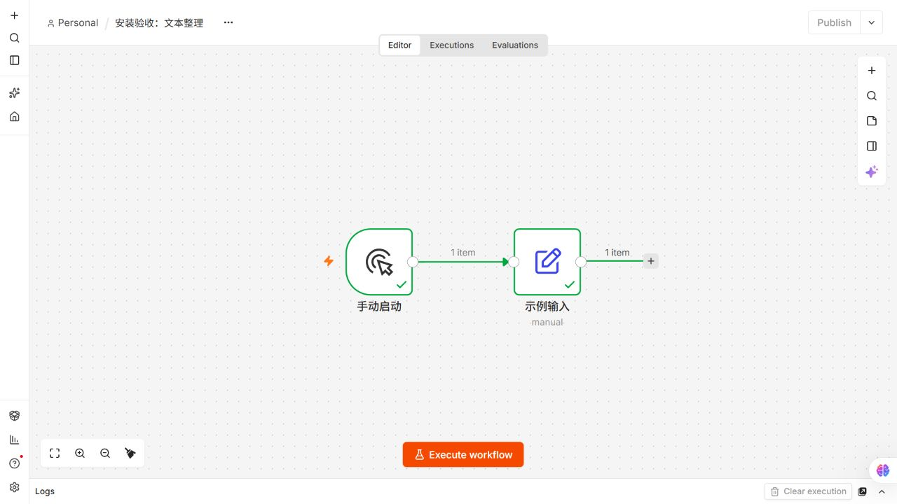
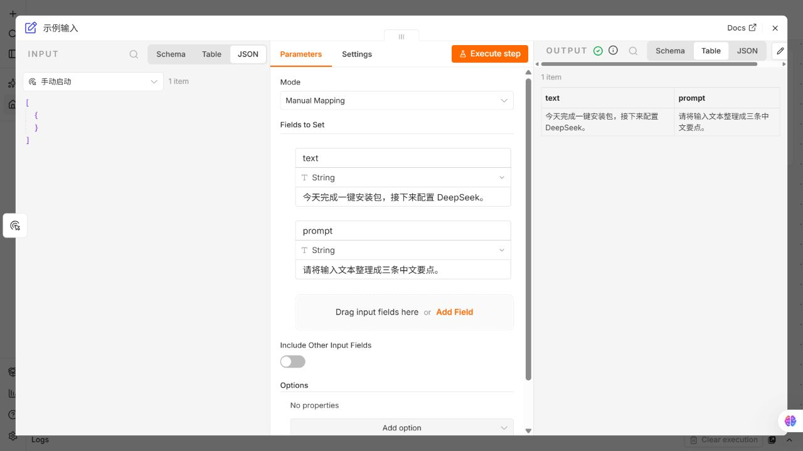

# 本机验收记录

日期：2026-10-12。项目根目录为 D:\demo_xianyu，目标仓库 weblogic678/ai-news。

| 项目 | 验收结果 |
| --- | --- |
| n8n 2.42.6 | Windows Docker 固定 digest 启动、网页 200、实际版本确认通过 |
| n8n 工作流 | 两份 JSON 实际导入；重复导入未重复创建；基础工作流在 CLI 与浏览器执行成功，中文输出一致 |
| n8n 数据保留 | 重启及迁移至 temp/private 后重新执行成功 |
| n8n 冷备份恢复 | 停机备份；恢复到独立项目、空 volume 和新端口；owner 保留，两个工作流导出和基础执行通过；恢复测试实例已停止 |
| Dify 1.17.1 | 配置与打包检查通过；固定镜像仍在下载，真实部署、工作流和恢复未完成 |
| Flowise 3.1.4 | 配置与打包检查通过；固定镜像仍在下载，真实部署和恢复未完成 |
| AnythingLLM 1.17.0 | 配置与打包检查通过；固定镜像仍在下载，真实部署和恢复未完成 |
| DeepSeek | 用户明确选择跳过真实调用；未产生模型测试费用 |
| Linux | 本机 WSL2 Debian 13 回归通过；独立 Linux 服务器未部署 |

n8n 固定镜像：n8nio/n8n:2.42.6@sha256:526daa38b68e923cc00c5280d18b4da5d489f115a73bdbf3b8e452b184197a9a。未用缓存旧版本代替其他产品的固定版本验收。

## 环境与回归

Windows 11 专业版 x64 10.0.28000；Python 3.14；Docker Desktop 4.93.0、Engine 29.8.1、Compose 5.5.1、desktop-linux，8 CPU / 约 7.63 GiB 内存。

安装、导入与保护回归：Windows 22 项通过；WSL2 Debian 13 / Python 3.13.5 同套 22 项通过。自动化回归此前 Windows 20 项通过、1 项跳过（符号链接权限）；WSL 全部 21 项通过。迁移后自动化回归复核得到相同结果。

发现并修复 Windows GBK 默认读取中文 UTF-8 文件的问题；安装器、导入器和 Docker 输出统一 UTF-8。PDF 原始样例因 Git CRLF 转换造成索引偏移，已恢复 LF 字节并设置 .gitattributes 将 PDF 保持为二进制，复测无解析警告。Dify 新增随机 Agent API token，替换上游开发用默认值。增加强制 GBK 导入回归，以及仓库运行映射禁止逃出 temp/private 的回归。

## 文件布局与隐私

- 根目录 images/：闲鱼发布主图及真实结果截图；文字主图明确区分已测与待验收。
- 根目录 发布描述.md：七个项目的集中发布文案。
- 各交付项目 Windows11/、linux-x86/：一键入口、说明、ZIP；Linux 另有 TAR.GZ 与校验值。
- temp/：维护脚本、测试、公开报告、来源许可、历史材料。
- temp/private/：私密账户、日志、运行映射、配置、数据与备份，Git 忽略，交付包不包含。

买家安装包默认使用自己的 runtime/；本仓库通过仅本机存在的映射把运行配置移至 temp/private/runtime/。Docker named volume 保留原数据，不做清空或广泛 prune。

## n8n 真实界面

以下来自实际本机 n8n 浏览器工作流运行，截图避开账户和凭据。

PDF 已从官方发行页下载 Windows v0.16.1 并校验 checksum，补测合并页数与顺序、拆分、优化、输入校验值不变、拒绝覆盖及一键示例，全部通过。结果见 PDF-WINDOWS-VALIDATION.json；下载程序与输出留 temp/private，不随包分发。CyberChef / Excalidraw 的既有验证细节保留在 temp/projects/，本轮未重测。

## 继续验收

三款固定镜像下载完成后，再记录产品启动、版本、重复运行、冷备份与独立恢复。Dify 另需真实导入与基础工作流运行。模型调用继续遵从用户的跳过选择。待验收项目不能因为配置测试或图片制作完成而标记通过。

## 同步与剩余阻塞

交付目录、图片、文案与公开维护资料已推送 GitHub main，bce1311；远端哈希核对一致。23 个 ZIP/TAR.GZ（含两份 Dify 上游配置 ZIP）的 SHA256、464 个成员路径与暂存公开内容检查通过，没有本机秘密、运行数据或备份。后续报告同步不改变这项验收结论。

Docker Desktop 直连 Registry 超时；Dify 插件拉取报 access denied，但通过本机命令环境网络路径可确认官方同一 digest 返回 HTTP 200，因此没有替换版本或借用旧镜像。仍尝试同 digest 镜像源；三款产品实机验收未完成。临时只读传输试验未成功，已停止，没有修改 Docker 全局网络设置。
